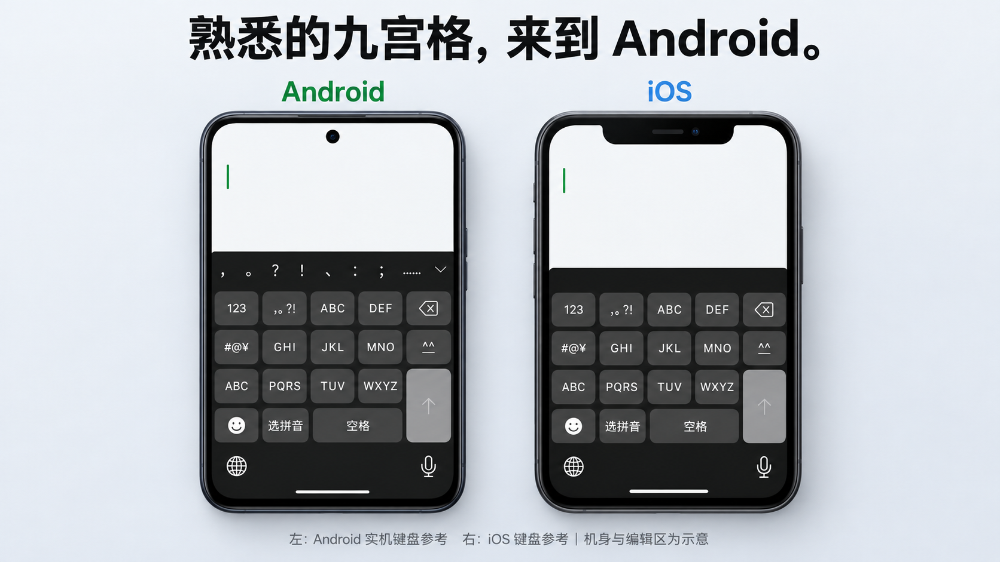
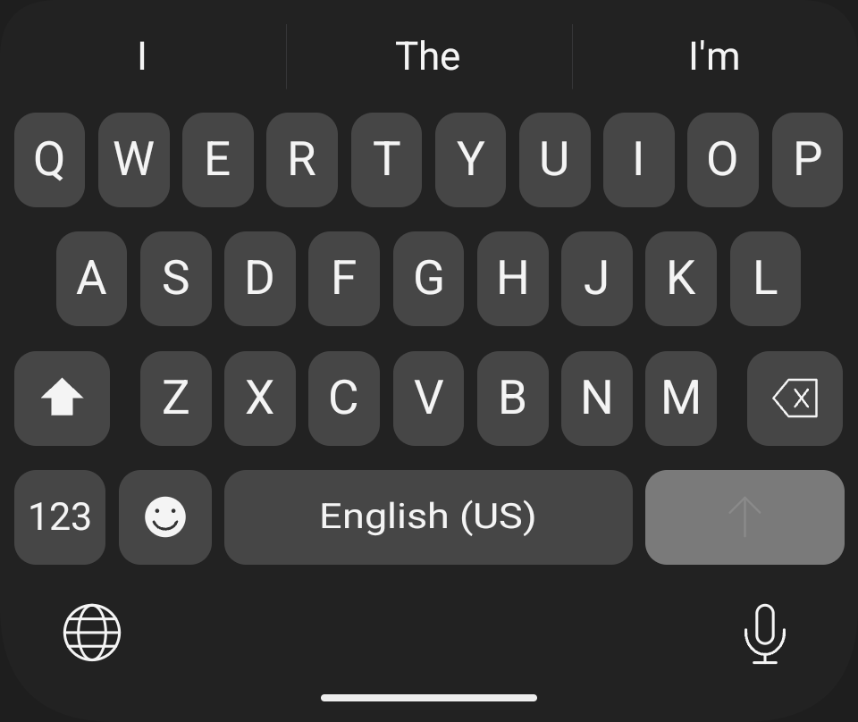
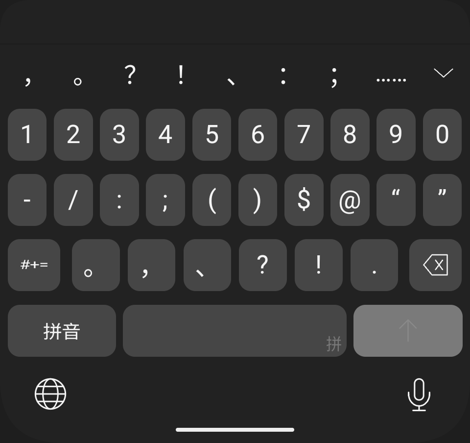

# iOSNineKeyIME for Android

**把熟悉的 iPhone 风格中文九宫格，带到 Android。**

🤝 **与 GPT 共创 · 通过 OpenAI Codex 协作开发**

一款基于 Trime/Rime 与万象的开源 Android 输入法。支持九键拼音、选拼音、英文、数字、符号和 Emoji，词库与输入引擎在本机离线运行。

<p align="center">
  
</p>

<p align="center"><b>左：Android 上的本项目输入法　｜　右：iOS 键盘参考</b><br />对照图依据截图制作，机身与编辑区为示意；<a href="docs/images/android-nine-key.png">查看 Android 原始实机键盘截图</a>。</p>

## 功能

- **中文九宫格**：数字编码输入、候选选词、部分选词和逐音节选拼音。
- **空闲标点栏**：未输入时显示常用标点，输入后切换候选，提交或删空后恢复。
- **五种面板**：中文九键、数字、符号、英文 QWERTY 和 Emoji。
- **本地输入引擎**：内置固定词库与模型，支持普通字段的本地学习和上下文排序。
- **隐私设计**：APK 不申请网络权限；敏感字段禁止读取周围正文和学习，必要结构信息仅在内存中使用。

<table>
  <tr>
    <td align="center"><br />英文</td>
    <td align="center"><br />符号</td>
  </tr>
</table>

## 当前版本

当前提供开发版本，尚无正式签名发布包。现有检查包为 ARM64；测试设备和 Android 版本范围见[测试记录](docs/testing/CONFIGURATION-20261024.md)，其他设备兼容性待验证。

已知问题包括部分 WebView 密码框退格不受支持、无障碍窗口坐标异常，以及部分宿主焦点兼容问题。完整性能与安全验收仍在进行。外观使用 Android 系统字体、系统 Emoji 和原创图形，与 iOS 的字形、动画和部分交互存在差异。详见[当前状态](docs/STATUS.md)与[已知问题](docs/OPEN_ISSUES.md)。

## 构建与使用

准备锁定的工具链后，在仓库根目录执行：

```sh
./scripts/gradle.sh :app:assembleDebug
```

APK 位于 `android/trime/app/build/outputs/apk/debug/`。安装后通过 Android 系统设置启用本输入法，再在输入法切换器中选择。完整说明见[开发手册](docs/DEVELOPMENT.md)和[使用指南](docs/USER_GUIDE.md)。

## 参与开发

本项目由[维护者](https://github.com/0x00000003)与 GPT（通过 OpenAI Codex）共创：维护者提出产品方向、提供交互参考与反馈，GPT/Codex 协助实现代码、排错、执行测试和编写文档。AI 协助的提交使用 `Co-authored-by` 记录，详见[共创与提交署名](docs/CONTRIBUTING.md)。

提交问题时请提供 Android 版本、设备显示设置、宿主应用和可复现步骤；请勿附带密码、聊天正文、用户词库或其他个人数据。

| 文档 | 内容 |
| --- | --- |
| [开发手册](docs/DEVELOPMENT.md) | 工具链、构建与测试命令 |
| [产品需求](docs/PRODUCT.md) / [界面规格](docs/UI_SPEC.md) | 功能和布局 |
| [架构](docs/ARCHITECTURE.md) / [开发约定](AGENTS.md) | 模块边界与贡献规则 |
| [测试](docs/TESTING.md) / [当前状态](docs/STATUS.md) | 验证范围与结果 |
| [安全设计](docs/SECURITY.md) / [资源来源](docs/COMPLIANCE.md) | 隐私边界、依赖与归属 |
| [截图来源](docs/images/README.md) | Android 实机图片与制品哈希 |

## 许可证与致谢

本项目原创程序与派生代码采用 [GPL-3.0-or-later](LICENSE)。Trime、librime、万象词库、模型及其他依赖保留各自许可证和版权声明，详见 [NOTICE](NOTICE.md) 与[资源来源](docs/COMPLIANCE.md)。

本项目为独立的 Android 输入法项目，与 Apple 无隶属关系；不包含 Apple 字体或原版图标素材。
