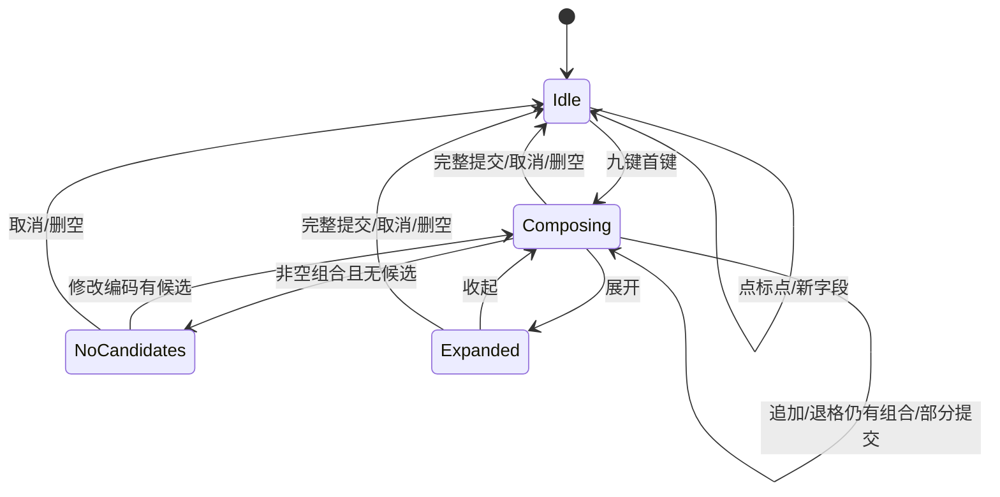

# UI、状态机和键位规格

## 证据等级
本文“产品决定”可以实现；“临时参数”可用于原型；“iOS 实际行为”必须有原图/录屏测量。参考资料包含5张591×1280深色JPEG，含九键/数字/符号/英文/Emoji；非正文尺寸/键框/颜色测量见spec/reference/ios-dark-v1.json和testing/REFERENCE_UI-20261023.md。原件/裁图只留ignored私有参考目录，不提交聊天或候选正文。iOS版本/显示设置、浅色、按下高亮/长按与动画时序尚未确认；不得把临时默认值或静态终态推测写成已验证iOS交互。机器规格见 [keyboard.json](../spec/keyboard.json)。

## 状态模型
以正交维度避免互相覆盖：layout = Chinese9 / Latin / Number / Symbols；composition = Idle / Composing / Expanded / NoCandidates；privacy = Normal / Sensitive；engine = Ready / Deploying / Error；editor = sessionId+revision+action。候选栏由状态推导，不通过零散的 show/hide 修改。Sensitive 包含密码与用户隐私开关：密码强制直接英文/数字、无候选；普通隐私模式可以显示不学习的候选但无历史上下文。Deploying/Error 是显式系统提示，不能伪装候选。

栏位优先：不可用引擎提示 > 密码屏蔽 > Composing/Expanded/NoCandidates > Chinese9 Idle 常用标点 > 其他布局的对应功能。引擎刚收到首键但候选尚未返回也立刻离开标点态，显示组合加载/无候选占位。取消/删空/整段上屏后立即显示标点，不等超时；只部分提交时继续候选。空栏不是“无组合”的可靠判断依据，以真实 preedit/composition 是否结束为准。

## 事件和动作（项目默认，参考补齐后逐项确认）
| 起态/事件 | 行为 | 终态与栏位 |
| --- | --- | --- |
| Idle 中文/点常用标点 | 通过统一提交出口插入一次该标点 | Idle，保留标点 |
| Idle/2–9 | 发数字编码到 Rime，不发到宿主 | Composing，立即候选占位 |
| Composing/候选点选 | 用当前会话稳定候选 ID 请求引擎提交 | 完整=Idle 标点；部分=继续候选 |
| Composing/空格 | 接受当前有效首选；无候选保留组合并提示，不静默发数字 | 由引擎提交结果决定 |
| Idle/空格 | 插入半角空格 | Idle |
| Composing/回车 | 优先确认有效候选，不在同一事件追加换行/Send | 组合结束或等待剩余组合 |
| Idle/回车 | 根据 EditorInfo 执行 Send/Search/Done/Next 或多行换行 | Idle；不伪造宿主功能 |
| Composing/标点 | 先确认可用候选，再插入一个标点；无可用候选不丢弃组合，提示 | 成功 Idle；失败保留组合 |
| Composing/退格 | 引擎删除一单位编码/选段 | 未空继续；删空 Idle 标点 |
| Idle/退格 | 删除选中宿主文本或前一字素簇 | Idle；不可只删半个 surrogate/ZWJ |
| 长按退格 | 临时400ms延迟、每60ms重复；离开命中区/抬起/字段结束取消 | 不得删到下一字段 |
| 展开/分页 | 仅有效候选可展开；分页请求绑定 revision | 无候选清楚提示，不露旧候选 |
| 布局切换且有组合 | 默认先请求确认有效候选再切换；无结果保持并给取消入口 | 不得无提示丢字；待iOS录屏核对 |
| 新字段/失焦/隐藏/服务重启 | 停止重复事件，finish/清理会话并失效回调，不跨字段自动提交 | 新 session，Idle |
| 光标移出组合/外部修改 | 与 InputConnection 核对 composing 区，取消失效组合/清上下文 | 不提交旧候选 |
| 过期候选/提交回调 | session/revision 不匹配即丢弃；已消费 commitId 不再提交 | 不改变当前 UI |

敏感模式、系统切换、旋转、用户按返回键与引擎部署均必须覆盖，不把状态全塞进 UI View。切隐私模式时先取消组合、清上下文、更换无学习会话；恢复普通模式重新初始化，不能把隐私会话缓存写回用户词库。

## 键位与触控（历史临时规格，正由下方参考替换）
语义编码映射已由上游九键 schema 核对：ABC→2、DEF→3、GHI→4、JKL→5、MNO→6、PQRS→7、TUV→8、WXYZ→9。每次触碰为一位歧义编码，**不能按字母轮转直接输出**。上游 1 键有符号/分隔绑定，必须与 UI 的标点功能区分，通过适配层处理，不能盲发 1。

核心3×3暂定：第一行“标点功能位 / ABC / DEF”；第二行“GHI / JKL / MNO”；第三行“PQRS / TUV / WXYZ”。这是待截图确认的布局候选，**不是已证实 iPhone 布局**。退格、符号、数字/中英、空格、回车、收起/切换键作为外围功能区，准确位置/宽度/文字从截图标注确定。不得使用 Apple 私有图形，使用原创矢量图或许可明确的 Android 图标。

临时设计变量：候选栏44dp、主键行52dp、间距6dp、外边距6dp、圆角6dp、字母18sp；后续由实测替换。核心键触摸高度最低48dp，边缘可延展但不与邻键重叠。可用宽度扣除左右 inset 后按比例分配；导航区不能算成空格键。按下命中后移出取消，触控坐标与绘制矩形来源相同；多指策略固定“一指主键，其他忽略”，无障碍探索独立处理。短按和长按互斥，抬起不能再触发短按。

空闲常用标点临时顺序：`， 。 ？ ！ 、 ： ； ……`，使用中文全角；省略号一次插入两字符`……`。获得原图后核对顺序、数量和是否需要滚动。长按备选标点/拼音消歧手势仅在有录屏证据后还原，当前先提供清晰的选段/展开能力。不得把不熟悉的手势臆测为 iOS 功能。

## 视觉验收流程
采集同一组合状态：空闲、首键、歧义编码、多音节、部分选词、上屏、删空、候选展开、标点、数字、符号、英文、密码、IME action、深色。每张图记录参考来源、系统设置、键盘边界、截图哈希；原图只读，标注与裁图另存。按键盘内容边界归一化比较，不包含宿主文本、状态栏和系统导航区。

先人工测核心键矩形/中心/标签/栏高/边距/圆角/颜色：默认几何误差≤可用键盘宽高1%，核心键中心≤1.5%；颜色按相同主题与色彩空间 DeltaE2000≤5（字形反锯齿单独说明）。数值是初始验收阈值，可在实际参考下记录 ADR 调整，不能事后为过关放宽。再输出叠图和差分/SSIM，字形平台差异不能被全图均分掩盖；每个差异逐项解释，进行体验验收。不保证 SF 字体、iOS 触感和私有联想算法等同。

## 五态参考布局规格

按可用键宽相对591px归一化，不把iPhone绝对像素直接搬到Pixel。九键和数字为五列四排；中文列1是123/#@¥/ABC/Emoji，列2—4为拼音九宫格，右列退格/颜文字/跨两排回车；底排为Emoji/选拼音/双宽空格/回车。数字为同位置的拼音、1—9、更多、0、标点和空格。符号有十键数字首排、十键符号第二排、混合宽度第三排与拼音/长空格/回车底排；英文为10/9/7字母的QWERTY，shift/退格及123/Emoji/长空格/回车。Emoji为搜索条、7列4个可见行、类别条、删除和底部工具。各键框/间隔以source测量JSON为准；暗色面板RGB34、主键RGB70，回车底RGB144或122为5×5 JPEG中位数，非按下态。

参考图展示123/#@¥/ABC及Emoji切换终态，必须实现真实面板与往返，不能只改文字或贴图。原R02空闲常用标点优先保持，按参考候选栏几何显示；不复制截图中的私人预测词。未知更多页/符号次页/选拼音/长按和高亮需标注哪些是项目实现决定，不能据五张静态图假称其交互已被证实。仅使用Android系统字形与原创矢量，未授权Apple字体/原图标不打包；Emoji使用系统字形，不读取iPhone常用历史。导航安全区域按实际Android inset调整并记录与参考的差异。核心触控高度与iPhone紧密QWERTY的矛盾须实测/可访问性核对，不静默降低R14门槛。

参考环境为iPhone13/iOS27.2，缩放/文字设置未知。当前用visualHeight将参考键面与48dp触控高度分开：绘图/文字保持测得的65/60来源px，可触控区域向空隙延展并仍不得重叠。Pixel实拍校准包括系统字体大小/字距、原创图形线宽与弱化空闲回车；需要以新制品重新测量，不把系统字形轮廓差异称为Apple字体等同。底部globe/mic图形可在安全触控框内偏移到参考视觉中心，但不能绘入系统手势区。

2026-10-24 圆角/页脚细校准（待新制品实拍）：五张原图下缘灰度坐标一致，source y1240/1255/1265/1275/1279的左侧panel34起点约9/16/28/46/64px。用80来源px二次曲线近似底角，深色角外背景30，保留原40px上角与同一触控框；不是原生曲线逐像素拟合。自绘globe/mic原白bbox约41.86×41.86/29.55×43.71，对照40×40/27×42，因此页脚图形系数0.72→0.68，仅缩图形不缩48dp触控。来源/实拍采样SHA仍由对应reference/capture记录约束，轮廓不是Apple资产。其他浅色/字号条件未补，待实际截图后记录误差，不能先写视觉PASS。

选拼音增量（2026-10-24）：现已接实际引擎音节查询/改写，4列×2行、每页8项、最多32项，48dp触控；可继续选下一音节、返回后点词、取消组合。选项以session/revision绑定，字段/隐藏结束清除，私密禁用。实际Pixel组件和系统触屏证据见testing/PINYIN_ANDROID-20261024.md；这是项目设计的二级页面，五张iOS参考没有覆盖，不称视觉/交互等价。
